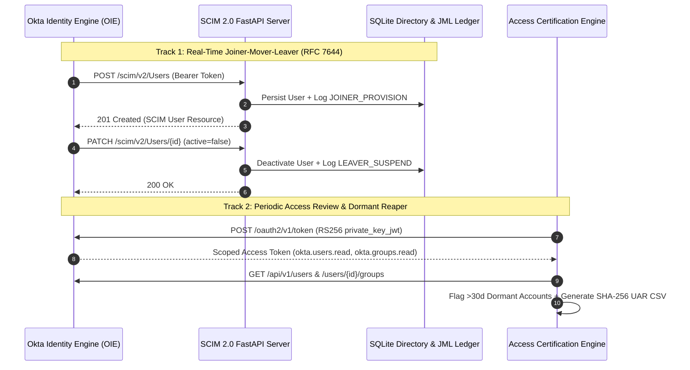

# SCIM 2.0 Provisioning Server & Automated Access Certification Engine

RFC 7643/7644 **SCIM 2.0 Service Provider** (FastAPI) paired with a zero-static-secret **User Access Review (UAR) & Dormant Account Certification Engine** for Okta Identity Engine (OIE).

---

## Architecture Overview

Modern Identity Governance and Administration (IGA) requires both **real-time Joiner-Mover-Leaver (JML) provisioning** and **continuous detective recertification**:

1. **Inbound SCIM 2.0 Provisioning (`scim_server/`):** Implements `/scim/v2/Users` and `/scim/v2/Groups` (`GET`, `POST`, `PUT`, `PATCH`, `DELETE`) backed by SQLite persistence and an append-only JML event ledger (`/governance/audit-events`).
2. **Outbound Access Certification (`governance/`):** Authenticates to Okta via OAuth 2.0 `private_key_jwt` (RS256) with least-privilege read scopes (`okta.users.read`, `okta.groups.read`), flags dormant accounts (`>30` days inactive), maps group entitlements, and exports a SHA-256 hashed UAR evidence packet.



---

## Repository Structure

```text
scim-iga-lifecycle-engine/
├── docs/
│   └── compliance-mapping.md              # NIST SP 800-53 & HIPAA Security Rule mapping
├── scim_server/
│   ├── __init__.py
│   ├── main.py                            # RFC 7643/7644 FastAPI SCIM 2.0 endpoints
│   ├── schemas.py                         # SCIM User, Group, PatchOp & Error models
│   └── storage.py                         # SQLite directory & JML audit event ledger
├── governance/
│   ├── __init__.py
│   └── access_certification_engine.py     # OAuth 2.0 private_key_jwt UAR & dormant auditor
├── requirements.txt
└── .gitignore
```

---

## Quickstart

### 1. Install Dependencies
```bash
python -m venv .venv && source .venv/bin/activate
pip install -r requirements.txt
```

### 2. Run the SCIM 2.0 Provisioning Server
```bash
export SCIM_BEARER_TOKEN="$(python -c 'import secrets; print(secrets.token_urlsafe(32))')"
uvicorn scim_server.main:app --host 0.0.0.0 --port 8443 \
  --ssl-keyfile /path/to/server.key --ssl-certfile /path/to/server.crt
```

The service refuses bearer-authenticated requests received over plaintext HTTP. If TLS is terminated by a
reverse proxy, bind Uvicorn to a loopback or private interface and start it with `--proxy-headers` and
`--forwarded-allow-ips` set to the proxy address. For isolated local development only, run
`SCIM_ALLOW_INSECURE_HTTP=true uvicorn scim_server.main:app --host 127.0.0.1 --port 8000`.

Test provisioning a SCIM user (use `--cacert` for a private CA):
```bash
curl -X POST https://localhost:8443/scim/v2/Users \
  -H "Authorization: Bearer $SCIM_BEARER_TOKEN" \
  -H "Content-Type: application/scim+json" \
  -d '{
    "schemas": ["urn:ietf:params:scim:schemas:core:2.0:User"],
    "userName": "jdoe@example.org",
    "name": {"givenName": "Jane", "familyName": "Doe"},
    "emails": [{"value": "jdoe@example.org", "primary": true}],
    "active": true
  }'
```

### 3. Run the Automated Access Certification Engine
```bash
export OKTA_ORG_URL="[https://dev-000000.oktapreview.com](https://dev-000000.oktapreview.com)"
export OKTA_CLIENT_ID="0oa..."
export OKTA_PRIVATE_KEY_FILE="/path/to/private_key.pem"
export INACTIVITY_THRESHOLD_DAYS=30

python -m governance.access_certification_engine
```

---

## Disclaimer
All code and templates are sanitized reference implementations built for architectural demonstration and sandbox testing.

---

## Author

**Anthony Pensabene, CISSP** — Identity Security Engineer & Okta Subject Matter Expert  
* **GitHub:** [github.com/apensabene](https://github.com/apensabene)
* **LinkedIn:** [linkedin.com/in/apensabene](https://linkedin.com//in/apensabene)
